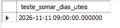
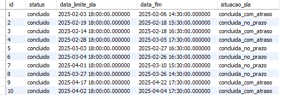
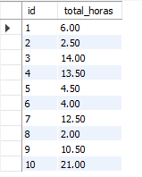
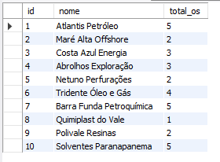
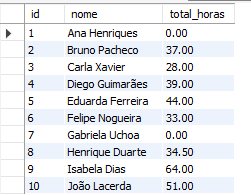
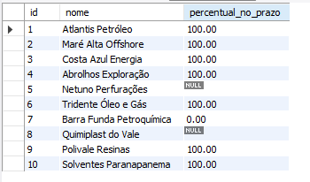

# Saídas das Functions

> **Pré-requisitos:** executar a criação do banco (`script_av3.sql`), a carga de dados (`seed_insert.sql`) e, em seguida, `functions.sql`.

## 1. `fn_somar_dias_uteis`

**Objetivo:** somar uma quantidade de dias úteis a uma data, considerando dias úteis de segunda a sexta-feira. Feriados não são considerados.

**Teste:** somar três dias úteis a uma sexta-feira.

```sql
SELECT fn_somar_dias_uteis(
    '2026-11-06 09:00:00',
    3
) AS teste_somar_dias_uteis;
```

**Resultado esperado:** `2026-11-11 09:00:00` (quarta-feira), pois sábado e domingo não entram na contagem.



## 2. `fn_situacao_sla`

**Objetivo:** classificar a situação do SLA de uma ordem de serviço. A função pode retornar `sem_sla`, `atrasada`, `em_risco`, `no_prazo`, `concluida_no_prazo` ou `concluida_com_atraso`.

**Teste:** consultar as primeiras ordens de serviço cadastradas e calcular a situação do SLA de cada uma.

```sql
SELECT
    id,
    status,
    data_limite_sla,
    data_fim,
    fn_situacao_sla(id) AS situacao_sla
FROM ordens_servico
ORDER BY id
LIMIT 10;
```

**Resultado esperado:** uma linha por ordem de serviço, com a classificação calculada conforme o status, a data limite do SLA e, quando concluída, a data de término.



## 3. `fn_total_horas_os`

**Objetivo:** somar os minutos registrados em apontamentos de uma ordem de serviço e retornar o total convertido em horas, com duas casas decimais.

**Teste:** consultar o total de horas apontadas para as primeiras ordens de serviço.

```sql
SELECT
    id,
    fn_total_horas_os(id) AS total_horas
FROM ordens_servico
ORDER BY id
LIMIT 10;
```

**Resultado esperado:** o total de horas de cada OS. Quando não houver apontamentos, a função retorna `0`.



## 4. `fn_total_os_cliente`

**Objetivo:** contar quantas ordens de serviço estão cadastradas para determinado cliente.

**Teste:** consultar a quantidade de OS dos primeiros clientes cadastrados.

```sql
SELECT
    id,
    nome,
    fn_total_os_cliente(id) AS total_os
FROM clientes
ORDER BY id
LIMIT 10;
```

**Resultado esperado:** uma linha por cliente, exibindo a quantidade de ordens de serviço relacionadas a ele. Se o identificador informado à função for `NULL`, o retorno será `0`.



## 5. `fn_total_horas_funcionario`

**Objetivo:** somar os minutos de todos os apontamentos de um funcionário e retornar o total convertido em horas, com duas casas decimais.

**Teste:** consultar o total de horas apontadas pelos primeiros funcionários cadastrados.

```sql
SELECT
    id,
    nome,
    fn_total_horas_funcionario(id) AS total_horas
FROM funcionarios
ORDER BY id
LIMIT 10;
```

**Resultado esperado:** uma linha por funcionário, com a soma das horas registradas. Quando não houver apontamentos, a função retorna `0`.



## 6. `fn_percentual_os_cliente_no_prazo`

**Objetivo:** calcular o percentual de ordens de serviço concluídas dentro do prazo de SLA para um cliente. São consideradas as OS concluídas que possuem data limite de SLA.

**Teste:** consultar o percentual de OS concluídas dentro do SLA para os primeiros clientes cadastrados.

```sql
SELECT
    id,
    nome,
    fn_percentual_os_cliente_no_prazo(id) AS percentual_no_prazo
FROM clientes
ORDER BY id
LIMIT 10;
```

**Resultado esperado:** percentual entre `0` e `100`, com duas casas decimais. A função retorna `NULL` quando o cliente não possui OS concluídas com data limite de SLA para o cálculo.


