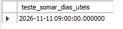
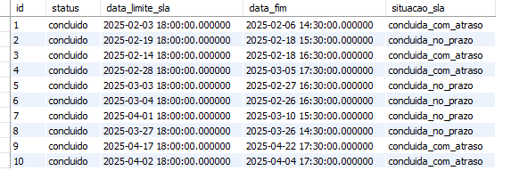
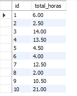
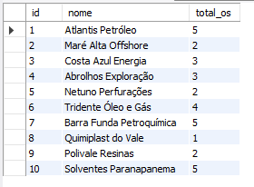
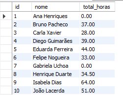
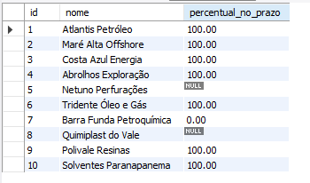

# Saídas das Functions 

## 1. Soma dias úteis (segunda a sexta), sem considerar feriados p_dias deve ser maior ou igual a zero
Teste : Deve somar 3 dias uteis a sexta-feira, chegando na quarta-feira
Comando usado: SELECT fn_somar_dias_uteis('2026-11-06 09:00:00', 3) AS teste_somar_dias_uteis;

## 2. Classifica a situação do SLA de uma ordem de servico
Teste: Situacao de SLA para as primeiras OS existentes
Comando: SELECT id, status, data_limite_sla, data_fim, fn_situacao_sla(id) AS situacao_sla FROM ordens_servico ORDER BY id LIMIT 10;

## 3. Retorna o total de horas apontadas em uma OS
Teste: Total de horas por OS
Comando: SELECT id, fn_total_horas_os(id) AS total_horas FROM ordens_servico ORDER BY id LIMIT 10;

## 4. Conta as ordens de servico de um cliente
Teste: Total de OS por cliente
Comando: SELECT id, nome, fn_total_os_cliente(id) AS total_os FROM clientes ORDER BY id LIMIT 10;

## 5. Soma as horas apontadas por um funcionário
Teste: Total de horas por funcionário
Comando: SELECT id, nome, fn_total_horas_funcionario(id) AS total_horas FROM funcionarios ORDER BY id LIMIT 10;

## 6. Percentual de OS concluídas dentro do SLA para um cliente, retorna NULL quando não há OS concluídas com SLA para calcular
Teste: Percentual de OS no prazo por cliente
Comando: SELECT id, nome, fn_percentual_os_cliente_no_prazo(id) AS percentual_no_prazo FROM clientes ORDER BY id LIMIT 10;

