# Evidências e saídas das Stored Procedures

> **Pré-requisitos e ordem de execução:**
> 1. `script_av3.sql` — criação das tabelas e relacionamentos;
> 2. `seed_insert.sql` — carga dos registros de demonstração;
> 3. `functions.sql` — criação das seis functions utilizadas pelos procedimentos;
> 4. `triggers.sql` — criação dos triggers que calculam SLA e registram auditoria;
> 5. `procedures.sql` — criação da VIEW e das seis Stored Procedures.

## Preparação dos testes

O bloco abaixo seleciona automaticamente um cliente ativo e um funcionário ativo, utilizando o departamento real do funcionário. Assim, não é necessário presumir que os IDs 1 ou 2 sejam compatíveis.

```sql
SELECT
    f.id,
    f.departamento_id,
    c.id
INTO
    @funcionario_teste,
    @departamento_teste,
    @cliente_teste
FROM funcionarios f
CROSS JOIN clientes c
WHERE f.ativo = TRUE
  AND c.ativo = TRUE
ORDER BY f.id, c.id
LIMIT 1;
```

## 1. `sp_abrir_os`

**Objetivo:** cadastrar uma nova ordem de serviço após validar os campos obrigatórios, o departamento, o cliente, o solicitante e, quando informados, o projeto e o local operacional. A procedure também registra a abertura na tabela `auditoria`.

**Teste:** criar uma OS de demonstração com cliente e funcionário ativos selecionados diretamente no banco.

```sql
CALL sp_abrir_os(
    @departamento_teste,
    @cliente_teste,
    @funcionario_teste,
    NULL,
    NULL,
    'manutencao',
    'alto',
    'TESTE PROCEDURE - Abertura de OS',
    'Registro criado pelo teste da procedure sp_abrir_os.',
    @nova_os
);
```
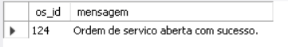

**Conferência da OS criada:**

```sql
SELECT
    id, departamento_id, cliente_id, solicitante_id,
    tipo, criticidade, status, titulo,
    prazo_dias_uteis, data_limite_sla
FROM ordens_servico
WHERE id = @nova_os;
```
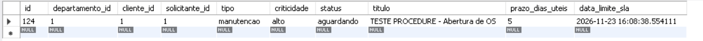

**Conferência da auditoria:**

```sql
SELECT *
FROM auditoria
WHERE os_id = @nova_os
ORDER BY id;
```
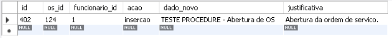

**Resultado esperado:** a procedure retorna o identificador da nova OS e uma mensagem de sucesso. A OS é criada com status `aguardando` e a abertura fica registrada na auditoria. O trigger de SLA também calcula o prazo automaticamente.

## 2. `sp_painel_sla`

**Objetivo:** apresentar as ordens de serviço ativas e não concluídas, exibindo cliente, departamento, responsável, criticidade, situação do SLA e horas apontadas. O resultado é priorizado pelas situações de SLA e pela criticidade.

**Teste geral:**

```sql
CALL sp_painel_sla(NULL);
```
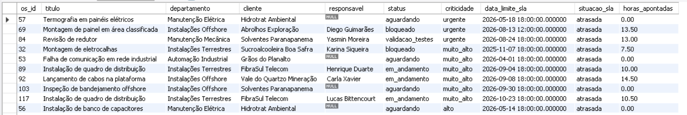

**Teste filtrado por departamento:**

```sql
CALL sp_painel_sla(@departamento_teste);
```
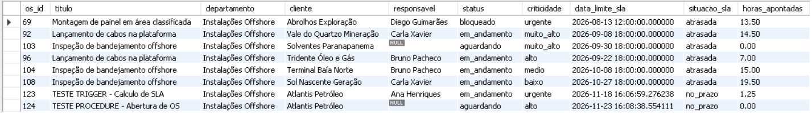

**Resultado esperado:** o primeiro comando apresenta as OS abertas de todos os departamentos. O segundo apresenta somente as OS do departamento selecionado. As situações mais críticas do SLA aparecem primeiro.

## 3. `sp_registrar_apontamento`

**Objetivo:** registrar o tempo trabalhado por um funcionário em uma ordem de serviço. A procedure verifica os parâmetros obrigatórios e a duração. O trigger `trg_apontamento_bi_validar` realiza as validações de funcionário e OS, enquanto `trg_apontamento_ai_auditoria` registra a inclusão.

**Teste:** utilizar a OS criada no teste 1 e o funcionário selecionado na preparação.

```sql
CALL sp_registrar_apontamento(
    @nova_os,
    @funcionario_teste,
    CURRENT_DATE(),
    90,
    'Teste real de apontamento de horas pela procedure.'
);
```
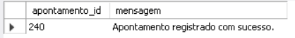

**Conferência do apontamento:**

```sql
SELECT *
FROM apontamento_horas
WHERE os_id = @nova_os
ORDER BY id DESC;
```
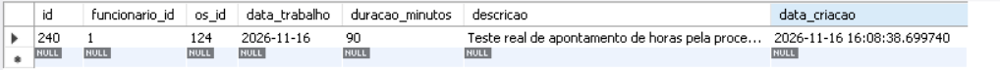

**Conferência da auditoria:**

```sql
SELECT *
FROM auditoria
WHERE os_id = @nova_os
ORDER BY id;
```
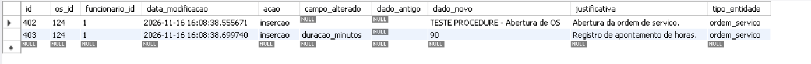

**Resultado esperado:** o apontamento é registrado com duração de 90 minutos e a inclusão gera um registro de auditoria.

## 4. `sp_relatorio_horas_departamento`

**Objetivo:** gerar um relatório de horas trabalhadas por departamento e funcionário. O procedimento utiliza a VIEW `vw_resumo_horas_funcionario`, `RIGHT JOIN` para preservar departamentos sem funcionários, `LEFT JOIN` para relacionar os totais e `EXISTS` para identificar funcionários com apontamentos.

**Teste geral:**

```sql
CALL sp_relatorio_horas_departamento(NULL);
```
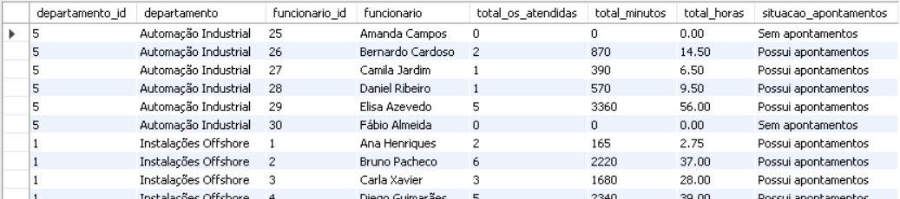

**Teste filtrado:**

```sql
CALL sp_relatorio_horas_departamento(@departamento_teste);
```
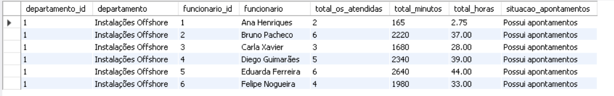

**Resultado esperado:** o relatório apresenta os departamentos e seus funcionários, quantidade de OS atendidas, total de minutos, total de horas e situação dos apontamentos. Departamentos sem funcionários também devem aparecer no relatório geral.

## 5. `sp_recalcular_sla_pendentes`

**Objetivo:** percorrer as ordens de serviço ativas e não concluídas, que utilizam SLA automático, e recalcular suas datas limite. O procedimento utiliza um `CURSOR` para processar as OS uma a uma e a function `fn_somar_dias_uteis` para calcular as novas datas.

**Teste:** antes de chamar o procedimento, alterar temporariamente a data limite da OS criada no teste 1 para uma data anterior à data de referência.

```sql
UPDATE ordens_servico
SET data_limite_sla = DATE_SUB(
    COALESCE(data_inicio, data_criacao),
    INTERVAL 1 DAY
)
WHERE id = @nova_os;
```

**Conferir a data antes do recálculo:**

```sql
SELECT
    id,
    prazo_dias_uteis,
    data_limite_sla AS sla_antes
FROM ordens_servico
WHERE id = @nova_os;
```

**Executar a procedure:**

```sql
CALL sp_recalcular_sla_pendentes();
```
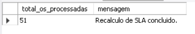

**Conferir a data depois do recálculo:**

```sql
SELECT
    id,
    prazo_dias_uteis,
    data_limite_sla AS sla_recalculado
FROM ordens_servico
WHERE id = @nova_os;
```
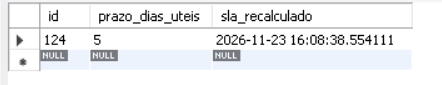


**Resultado esperado:** a procedure informa a quantidade de OS processadas e a data limite da OS de teste volta a corresponder ao prazo calculado em dias úteis. O trigger de auditoria pode registrar a alteração da data limite.

## 6. `sp_concluir_os`

**Objetivo:** concluir uma ordem de serviço, verificando se ela está ativa, ainda não foi concluída e se o funcionário responsável está ativo e pertence ao mesmo departamento da OS. O procedimento registra o parecer técnico e utiliza variáveis de sessão para identificar o autor da alteração na auditoria.

**Teste:** concluir a OS criada no teste 1, utilizando o funcionário selecionado na preparação.

```sql
CALL sp_concluir_os(
    @nova_os,
    @funcionario_teste,
    'Servico de teste concluido e validado.'
);
```
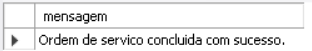

**Conferência da OS:**

```sql
SELECT
    id, status, responsavel_id, data_inicio,
    data_fim, parecer_tecnico
FROM ordens_servico
WHERE id = @nova_os;
```
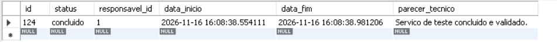

**Conferência da auditoria:**

```sql
SELECT *
FROM auditoria
WHERE os_id = @nova_os
ORDER BY id;
```
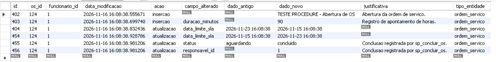

**Resultado esperado:** a OS passa para o status `concluido`, recebe o funcionário como responsável, registra o parecer técnico e recebe a data de conclusão. O trigger `trg_os_bu_regras_status` preenche a data de fim e `trg_os_au_auditoria` registra as alterações.

---

## Observações para a execução

- Os testes devem ser executados na ordem apresentada.
- O teste 1 cria a variável `@nova_os`, utilizada nos testes 3, 5 e 6.
- O teste 3 cria um apontamento e sua auditoria.
- O teste 5 altera temporariamente a data limite da OS para demonstrar o recálculo pelo cursor.
- O teste 6 conclui a OS de demonstração. Por isso, execute o teste 6 por último.