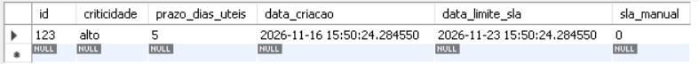
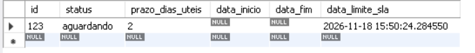
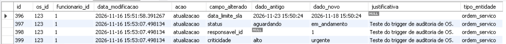
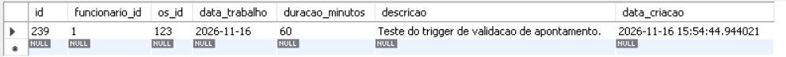
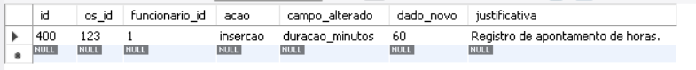
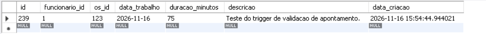
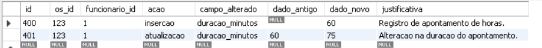

# Evidências e saídas dos Triggers

> **Pré-requisitos:** executar `script_av3.sql`, `seed_insert.sql` e `functions.sql` antes de criar os triggers. Em seguida, executar `triggers.sql`.

## Preparação dos testes

O comando seleciona um funcionário ativo e um cliente ativo. O departamento utilizado será o departamento real do funcionário selecionado.

```sql
SELECT
    f.id,
    f.departamento_id,
    c.id
INTO
    @funcionario_trigger_teste,
    @departamento_trigger_teste,
    @cliente_trigger_teste
FROM funcionarios f
CROSS JOIN clientes c
WHERE f.ativo = TRUE
  AND c.ativo = TRUE
ORDER BY f.id, c.id
LIMIT 1;
```

## 1. `trg_os_bi_calcula_sla`

**Evento:** `BEFORE INSERT` na tabela `ordens_servico`.

**Objetivo:** calcular automaticamente o prazo em dias úteis e a data limite do SLA quando uma nova OS é inserida com `sla_manual = FALSE`.

**Teste:** inserir uma OS com criticidade `alto`, sem informar prazo ou data limite.

```sql
INSERT INTO ordens_servico (
    departamento_id, cliente_id, solicitante_id,
    tipo, criticidade, descricao, titulo, status, sla_manual
)
VALUES (
    @departamento_trigger_teste,
    @cliente_trigger_teste,
    @funcionario_trigger_teste,
    'manutencao',
    'alto',
    'OS criada para testar o calculo automatico do SLA pelo trigger.',
    'TESTE TRIGGER - Calculo de SLA',
    'aguardando',
    FALSE
);

SET @os_trigger_teste = LAST_INSERT_ID();

SELECT
    id, criticidade, prazo_dias_uteis,
    data_criacao, data_limite_sla, sla_manual
FROM ordens_servico
WHERE id = @os_trigger_teste;
```

**Resultado esperado:** a OS é inserida com prazo de 5 dias úteis, pois a criticidade é `alto`, e recebe uma data limite de SLA calculada automaticamente.



## 2. `trg_os_bu_regras_status`

**Evento:** `BEFORE UPDATE` na tabela `ordens_servico`.

**Objetivo:** aplicar regras de consistência ao atualizar uma OS. O trigger controla a data de início e a data de fim de acordo com o status e recalcula o SLA quando o prazo ou a data de início são alterados.

**Teste:** alterar o prazo da OS criada no teste 1.

```sql
UPDATE ordens_servico
SET prazo_dias_uteis = 2
WHERE id = @os_trigger_teste;

SELECT
    id, status, prazo_dias_uteis,
    data_inicio, data_fim, data_limite_sla
FROM ordens_servico
WHERE id = @os_trigger_teste;
```

**Resultado esperado:** o prazo passa para 2 dias úteis e a data limite do SLA é recalculada automaticamente.



## 3. `trg_os_au_auditoria`

**Evento:** `AFTER UPDATE` na tabela `ordens_servico`.

**Objetivo:** registrar na tabela `auditoria` as alterações relevantes realizadas em uma OS, como status, responsável, criticidade e data limite do SLA.

**Teste:** alterar status, responsável e criticidade da OS de demonstração.

```sql
SET @funcionario_atual = @funcionario_trigger_teste;
SET @justificativa = 'Teste do trigger de auditoria de OS.';

UPDATE ordens_servico
SET status = 'em_andamento',
    responsavel_id = @funcionario_trigger_teste,
    criticidade = 'urgente'
WHERE id = @os_trigger_teste;

SET @funcionario_atual = NULL;
SET @justificativa = NULL;

SELECT *
FROM auditoria
WHERE os_id = @os_trigger_teste
ORDER BY id;
```

**Resultado esperado:** a auditoria apresenta registros de atualização para os campos alterados. O autor será o funcionário definido em `@funcionario_atual` durante a atualização.



## 4. `trg_apontamento_bi_validar`

**Evento:** `BEFORE INSERT` na tabela `apontamento_horas`.

**Objetivo:** impedir a inclusão de apontamentos com duração inválida, data ausente, funcionário inexistente/inativo ou OS inexistente/inativa/concluída. Também verifica se o funcionário pertence ao mesmo departamento da OS.

**Teste:** inserir um apontamento válido na OS de demonstração.

```sql
INSERT INTO apontamento_horas (
    funcionario_id, os_id, data_trabalho,
    duracao_minutos, descricao
)
VALUES (
    @funcionario_trigger_teste,
    @os_trigger_teste,
    CURRENT_DATE(),
    60,
    'Teste do trigger de validacao de apontamento.'
);

SET @apontamento_trigger_teste = LAST_INSERT_ID();

SELECT *
FROM apontamento_horas
WHERE id = @apontamento_trigger_teste;
```

**Resultado esperado:** o apontamento válido é inserido. Se a duração for zero ou negativa, ou se funcionário/OS não atenderem às regras, o trigger interrompe a operação com uma mensagem de erro.



## 5. `trg_apontamento_ai_auditoria`

**Evento:** `AFTER INSERT` na tabela `apontamento_horas`.

**Objetivo:** registrar automaticamente na tabela `auditoria` a inclusão de um apontamento de horas.

**Teste:** consultar a auditoria após a inserção realizada no teste 4.

```sql
SELECT
    id, os_id, funcionario_id, acao,
    campo_alterado, dado_novo, justificativa
FROM auditoria
WHERE os_id = @os_trigger_teste
  AND campo_alterado = 'duracao_minutos'
ORDER BY id;
```

**Resultado esperado:** deve existir um registro com ação `insercao`, campo `duracao_minutos`, valor `60` e justificativa `Registro de apontamento de horas.`.



## 6. `trg_apontamento_au_auditoria`

**Evento:** `AFTER UPDATE` na tabela `apontamento_horas`.

**Objetivo:** registrar alterações realizadas na duração de um apontamento, armazenando o valor anterior e o novo valor.

**Teste:** alterar a duração do apontamento criado no teste 4.

```sql
UPDATE apontamento_horas
SET duracao_minutos = duracao_minutos + 15
WHERE id = @apontamento_trigger_teste;

SELECT *
FROM apontamento_horas
WHERE id = @apontamento_trigger_teste;

SELECT
    id, os_id, funcionario_id, acao,
    campo_alterado, dado_antigo, dado_novo, justificativa
FROM auditoria
WHERE os_id = @os_trigger_teste
  AND campo_alterado = 'duracao_minutos'
ORDER BY id;
```

**Resultado esperado:** a duração passa de 60 para 75 minutos e a auditoria registra `60` em `dado_antigo` e `75` em `dado_novo`.





---

## Teste adicional de validação

O comando abaixo é opcional e deve ser executado separadamente, pois a resposta esperada é um erro SQLSTATE `45000`.

```sql
INSERT INTO apontamento_horas (
    funcionario_id, os_id, data_trabalho,
    duracao_minutos, descricao
)
VALUES (
    @funcionario_trigger_teste,
    @os_trigger_teste,
    DATE_ADD(CURRENT_DATE(), INTERVAL 1 DAY),
    0,
    'Teste de duracao invalida.'
);
```

**Resultado esperado:** a inserção é recusada com a mensagem `A duracao do apontamento deve ser maior que zero.`.

## Observações para as saídas

- Os testes 1 a 6 devem ser executados na ordem apresentada.
- O teste 1 cria a OS usada pelos demais testes.
- O teste 4 cria o apontamento usado nos testes 5 e 6.
- O teste 3 altera a OS para `em_andamento`, mantendo-a aberta para receber apontamentos.
